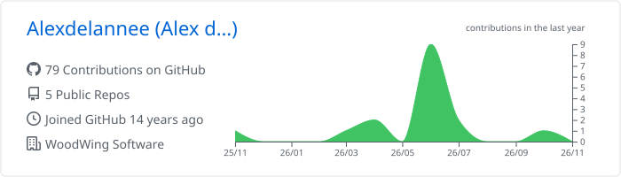
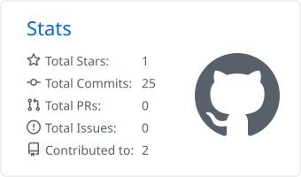
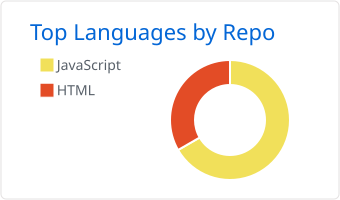
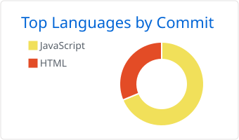

### Hi there 👋

<picture>
  <source media="(prefers-color-scheme: dark)" srcset="https://raw.githubusercontent.com/Alexdelannee/Alexdelannee/main/profile-summary-card-output/github_dark/0-profile-details.svg">
  
</picture>

<picture>
  <source media="(prefers-color-scheme: dark)" srcset="https://raw.githubusercontent.com/Alexdelannee/Alexdelannee/main/profile-summary-card-output/github_dark/3-stats.svg">
  
</picture>

<picture>
  <source media="(prefers-color-scheme: dark)" srcset="https://raw.githubusercontent.com/Alexdelannee/Alexdelannee/main/profile-summary-card-output/github_dark/1-repos-per-language.svg">
  
</picture> <picture>
  <source media="(prefers-color-scheme: dark)" srcset="https://raw.githubusercontent.com/Alexdelannee/Alexdelannee/main/profile-summary-card-output/github_dark/2-most-commit-language.svg">
  
</picture>
